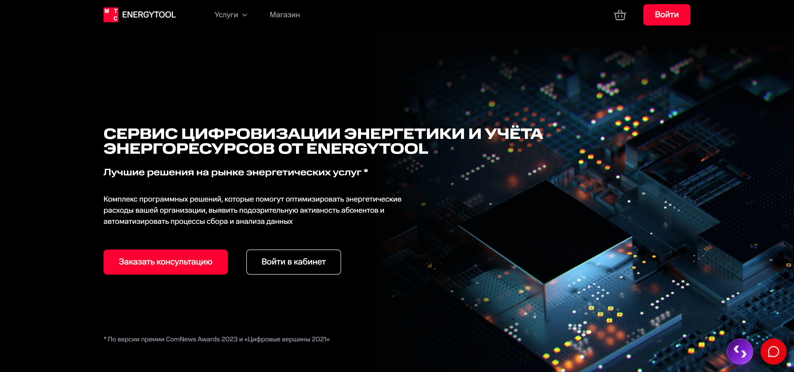
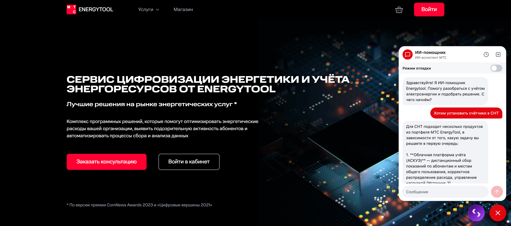
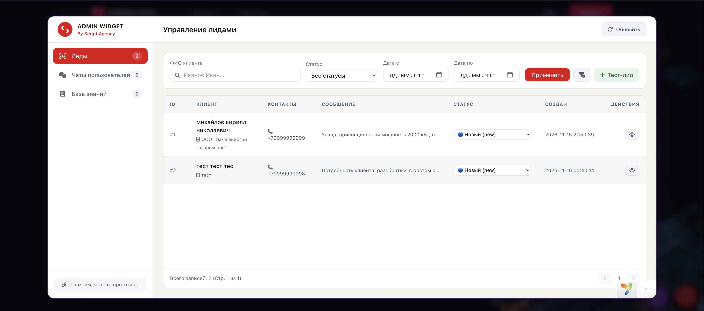

# MVP Release — ИИ-консультант для сайта Energytool

**Дата релиза:** 16 ноября 2026  
**Версия:** v1.0.0-mvp  
**Команда:** Script Agency (Hack&Change 2026)

---

## 1. Назначение сервиса

ИИ-консультант помогает посетителю сайта Energytool (МТС) сформулировать задачу в области энергопотребления, уточняет обстоятельства, ищет подтверждённую информацию в базе знаний компании, объясняет подходящее решение простым языком и при согласии пользователя формирует заявку менеджеру с полным резюме диалога.

**Целевая аудитория:**
- Представители малого и среднего бизнеса (снижение расходов, ценовые категории, учёт)
- Энергетики и инженеры предприятий (учёт ресурсов, выявление потерь)
- Представители СНТ (учёт потребления, управление приборами)
- Сетевые и ресурсоснабжающие организации (выявление вмешательств в работу счётчиков)
- Региональные менеджеры B2B (быстрые точные ответы о продуктах)

**Ключевая бизнес-ценность:** замена первого контакта с менеджером — пользователь получает ответы сразу, а менеджер приходит уже с полным контекстом переписки.

---

## 2. Изначальный планируемый объём MVP

### Функциональные требования (из HACKATHON_REQUIREMENTS.md)

| ID | Требование | Описание |
|----|-----------|----------|
| FR-01 | Анонимная сессия | Первое сообщение создаёт уникальную запись сессии |
| FR-02 | Контекст сессии | Последующие вопросы учитывают историю текущего диалога |
| FR-03 | Изоляция нового диалога | Факты старой сессии не попадают в новый контекст |
| FR-04 | RAG-поиск | Поиск по базе знаний с ранжированием чанков |
| FR-05 | Выявление потребности | Уточняющие вопросы при недостатке данных |
| FR-06 | Объяснение решения | Рекомендация привязана к источникам из базы знаний |
| FR-07 | Отказ от неподтверждённого | При отсутствии данных — прямой отказ |
| FR-08 | Границы компетенции | Вопрос вне области → перенаправление специалисту |
| FR-09 | Предложение связи | Пользователь может согласиться или отказаться |
| FR-10 | Сбор контактов | ФИО, телефон, компания с валидацией и подтверждением |
| FR-11 | Резюме диалога | Потребность, обстоятельства, решение, открытые вопросы |
| FR-12 | Сохранение истории | Все сессии сохраняются, даже без заявки |
| FR-13 | Debug-режим | Время ответа, токены, использованные источники |
| FR-14 | Обработка сбоев | Тайм-ауты и ошибки обрабатываются контролируемо |
| FR-15 | Docker-запуск | Чистый запуск по README одной командой |

### Технические артефакты (из IMPLEMENTATION_PLAN.md)

- REST API с префиксом `/api/v1`
- OpenAPI/Swagger UI
- JSON Schema внутреннего контракта PHP↔Python
- Docker Compose (postgres, redis, php-fpm, nginx-backend, generation, nginx-frontend)
- Миграции БД (сессии, сообщения, заявки, документы, outbox)
- ADR (Architecture Decision Records)
- Seed-данные базы знаний

### Критерии приёмки (AC)

| AC | Описание |
|----|----------|
| AC-01 | Чистый Docker-запуск по инструкции |
| AC-02 | Создание и продолжение диалога |
| AC-03 | Новый диалог не использует прежний контекст |
| AC-04 | История сохраняется и без заявки |
| AC-05 | RAG возвращает источники, доступные в debug |
| AC-06 | Неоднозначный запрос → уточнение |
| AC-07 | Отсутствие подтверждения → отказ, не выдумка |
| AC-08 | Заявка: ФИО, телефон, компания, подтверждение |
| AC-09 | Заявка связана с резюме и сессией |
| AC-10 | Debug: время и документы |
| AC-11 | Сбой AI API → история не теряется |
| AC-12 | README, Docker, lock-файлы, .env.example, API-описание |

---

## 3. Полученный результат

### 3.1. Сквозной сценарий (работает end-to-end)

#### Демонстрация работы

**Демо-страница:** после запуска `docker compose up` и загрузки базы знаний, откройте [http://localhost/demo](http://localhost/demo).

Виджет ИИ-помощника отображается справа снизу в виде плавающей кнопки. Нажатие открывает панель чата.

**Основной пользовательский сценарий:**

1. Пользователь нажимает на иконку чата → открывается панель
2. Пишет вопрос, например: *«Хочу установить трёхфазный счётчик на производстве, какие документы нужны?»*
3. Python Generation Service:
   - Получает вопрос и историю от PHP-бэкенда
   - Формирует поисковый запрос
   - Выполняет BM25-ранжирование по чанкам базы знаний
   - Собирает контекст (документы + история + системный промпт)
   - Отправляет в AI-провайдер
4. AI возвращает структурированный JSON: `answer`, `handoff`, `sources`, `summary`, `is_completed`
5. Ответ отображается в чате со ссылками на источники
6. При необходимости AI задаёт уточняющие вопросы
7. Когда информации достаточно — предлагает оставить заявку
8. Пользователь соглашается → вводит ФИО, телефон, компанию → заявка сохраняется с резюме диалога

### 3.2. Скриншоты разработанного решения

#### Пользовательский интерфейс — виджет ИИ-помощника (демо-страница Energytool)

Виджет отображается как плавающая кнопка в правом нижнем углу сайта. Нажатие открывает панель чата:

*Демо-страница Energytool с кнопкой-лаунчером виджета ИИ-помощника.*

Открытая панель чата: пользователь задаёт вопрос, ассистент отвечает с уточнениями и предлагает сценарии действий:

*Открытая панель чата с диалогом ИИ-консультанта на демо-странице Energytool.*

#### Админ-панель — принятые заявки

Раздел «Принятые заявки»: список лидов с ФИО, телефоном, компанией, статусом и привязкой к сессии диалога:

*Админ-панель: просмотр заявок (лидов), собранных виджетом, с деталями и статусами.*

### 3.3. Пользовательские сценарии (проверка)

| Сценарий | Описание | Статус |
|----------|----------|--------|
| **Новый диалог** | Начать чат → задать вопрос → получить ответ с источниками | ✅ Реализовано |
| **Уточнение** | AI запрашивает дополнительные детали (мощность, регион и т.д.) | ✅ Реализовано |
| **Отказ от неподтверждённого ответа** | AI сообщает, что информация отсутствует в базе знаний | ✅ Реализовано |
| **Handoff специалисту** | Вопрос вне компетенции → предложение связаться с менеджером | ✅ Реализовано |
| **Оформление заявки** | Согласие → ввод данных → сохранение заявки с резюме | ✅ Реализовано |
| **История диалогов** | Просмотр всех предыдущих сессий | ✅ Реализовано |
| **Debug-режим** | Отображение времени ответа, токенов и источников | ✅ Реализовано |
| **Новый диалог после заявки** | Сброс контекста, начало нового чата | ✅ Реализовано |
| **Админ-панель** | Управление AI-настройками, просмотр заявок, база знаний | ✅ Реализовано |

### 3.4. Архитектурные диаграммы (PlantUML)

#### Общая схема работы

*Диаграмма: пользователь → браузер → nginx-frontend → React Widget → PHP API → Generation Service → AI Gateway*

#### Детальная диаграмма последовательности

![Sequence Diagram](https://www.plantuml.com/plantuml/png/dLTlRnD74tz_ds8KNZosi6Cd93p1KXum8Gvv7Wci9EXHXL5qEQ-TLSwxxkuvmOeiXQ2MIgMgYYfLwXlweX_01TA64DAlSFSL-2ITkVNzkSF92uI4RtTcPsP_yvkToHtjsSeRz5peCi6KxN4foXqbXST4k-pOhclz2rRm1pgkFAX1OoA2Jz--WkRz9XI-uhneLaDlLmeeD6pjrPlhnKJbVq8UkApTPPKLszbbAKbz7TPiZntOGxE9Q_hPOBelXMQMfVUuwDlAxi6X1N3NTlQwIWv4UqMwKi6rnbBZLgEEaYRUWZkyRmllhbHjfYOAywiBrSKRMOK6Nc4YdglFrUTNKVn0UYntSEdcoXnAwah9W-pcoB9sv5EOYS4e-A_yK_-T_wT_4XmNP-3QlSNLfNiBUBgVk8MPj5PBh2BUtU6Mb6vTQwuzL9a1MyF_EIBbMMGNlKnS4LfqUzmra9EJXTMRZRcy4zBSa0EFgPQe94cjEBksiT_SxHjv_kHQhBo2zrBITSb6mVyxEF8l_BFWcNzQZ2mqbNmwp1k8ymoOV_JE1NeHTcL_hh8NYK83iMAzp_D64afaBTWykKATJrJoA1aA9XU1JQRskSDQ8g8br9QgrIh1rrYaVtdtaHgwd8fUAE_pox6BFTf27p1LC92XV2Au5BGeQOf-9yVCtkL7cASusmzFcS_uO2IPGeyLbpFXjSJzhQrcsJ_pFo0hJ_oFmN6KNAEGO6ixdbH8tzT8Wm_1I_yl_7tZZuDZF8RhyDWZZRwivMMOcuNB5C6_m4-YqzX_Wni_KY40VbuOZWNFO7dP8ajG_i-a3cePkMKsKPpGk0RDXvjRKB7xF9-nbZZyUi0qhKlGOrhRNQPBu21vkb8DjxKxwEhPsTcH9QJ7GF7kBZeKNIwUGfhsmL7md68DdSIlruwfHykAGg6mu-AeWUs4jOHn58eP1rY_G5dceXiQcr9u1ilvMN8qDHI49Nfn4RF8AGOGCTJ0Cet7M0mc8_u5O8h64RZ-6FmpN9u1EdWM70SlYs4KD-ACFWzU45E8BwHg4liMpnxXrlimlHGmHJI9WW9Ak5-3IL4e5kQbQ2Kor4ouLujon9b6yE9zLCey7ZLOMzs2gGzD9R5WfOz0EUleyI6ne0J2xh4Ij9bs5EyJLgCI83MUf9tdBkDoxO7if68DyLf0l7v3B9uZFAU8rbjC84AT1mpfVuv8vI28E6rUWOIzYOyITAHoMDkmjsYP4vy5zrWpbpbUfFUa555kcukE30DTd9xOTyGrPDcvUHMeXf4dA1s76k-d11szDXYt-Ko7dWsa19xiR-yLhVXGDlE9XMoPbX3k7lUMRrIlv0EI_Z92H8RnLOXCRwOiZwwcINm6IIATGGztrzkObt04y6wNMYBwVgJSH2TSk18FInKIQfHdL0eyxh6UuT1DJCql2FXRgdS4_ymKvmKbnAG5DmfKf_Hy0oRcX5u4BbmkM1dJzqFmdNzIn5HTYdE7USxkzixGmn9JpBKzli-s1yejKiz_HyzpwaBWdvAZzBM-i2mHWag7k-nAjCEeu7eKGDaRzjdbi2dxm9m8eVitGlShtPyUIzE08cQV8fBOU12s5y5FkFaHnLYDG9ZIyqgeNWMPG-FhDlNJ0lqNP_zB6Kb6TEMGjqSLCatCZ03UOFjSX-M3IiagyfZjM6lATbXdu4ARTPNTDgFFfwEVMyA_81pyFmo132t6XYwu-O4gFUaffZ-_eSyGoIL4ybNmlMdZE9ld2Z-73VKvFTH8uUs-ahs-bxJSB3x9-3O579j7dTlOQkPCZQpuTCwK_phfabGB3_jCrDVBk2GEd9kUXbYSuutUquIQMChJxt22CZwrN72zky5iJU0FA8JH5Hq1CLBHtow4u2r4yFVmkJ-VmaOpsY0bKJBEmE-FyrYd6_kXwQ8bq7AW7ARZfvtwrywWUtkKjD_CH39VhS9_Dny-ICqBsKcAX53uVDxmppyR3T9JJpAjXHRAoKNID3KPEeKq9uDlQYsnM9qdjjBeCBdlgb9IaM0X56pn7aDNj54DDzODOLnWf6X5Oo45GkDZBGKbN4UaAMRSUa7G4-CjwmuJxK7F_GS0)

*Полная диаграмма последовательности: от открытия чата до сохранения заявки, включая RAG-пайплайн и AI-вызов*

#### Логическая схема системы

*PHP Core — единственный источник истины, Python — оркестратор RAG, React Widget — встраиваемый микрофронтенд*

### 3.5. Ключевые технические решения

| Решение | Выбор | Обоснование |
|---------|-------|-------------|
| **Бэкенд** | PHP 8.1 + Yii2 | Clean Architecture, DDD, CQRS — зрелая кодовая база команды |
| **Фронтенд** | React 19 + TypeScript (FSD) | Встраиваемый микрофронтенд через Shadow DOM, не влияет на сайт хостера |
| **Generation** | Python FastAPI | RAG-пайплайн + оркестрация диалога, изолирован от доменной модели |
| **Хранилище** | PostgreSQL + Redis | Транзакционная консистентность (PG) + кэш знаний и outbox (Redis) |
| **AI Gateway** | OpenAI-compatible API | Заменяемый провайдер (OpenAI, GigaChat, YandexGPT, LM Studio) |
| **Поиск** | BM25 (chunk-based) | Достаточен для MVP; pgvector — кандидат на будущее |
| **Упаковка** | Docker Compose | Полное окружение одной командой |

---

## 4. Что не закрыто из запланированного и почему

### 4.1. Функциональные пробелы

| Требование | Статус | Причина |
|-----------|--------|---------|
| **Pgvector / embedding-based retrieval** | ❌ Не реализовано | BM25 выбран как baseline; pgvector требует тестов на реальной выборке. Решение отложено до Production. |
| **Reranking** (P1 по ROADMAP) | ❌ Не реализовано | BM25 + top_k выборка дают приемлемое качество на MVP. |
| **Streaming (SSE)** | ❌ Не реализовано | Требует переработки контракта PHP↔Python и поддержки SSE в AiClient. |
| **Production RBAC / Auth** | ❌ Не реализовано | На MVP все сессии анонимные, админ-эндпоинты не защищены (документировано). |
| **CRM / Email интеграции** | ❌ Не реализовано | Сознательно исключено из MVP (см. HACKATHON_REQUIREMENTS.md). |
| **Webhook-уведомления** | ❌ Не реализовано | Отложено до внедрения event-системы. |
| **Soft Delete / Archiving для лидов** | ❌ Не реализовано | В MVP лиды физически не удаляются. |
| **Полнотекстовый поиск (FULLTEXT)** | ❌ Не реализовано | LIKE-поиск достаточен для объёмов MVP. |

### 4.2. Технические пробелы

| Артефакт | Статус | Причина |
|----------|--------|---------|
| **Unit-тесты** | ⚠️ Частично | Есть тесты для KnowledgeRouter, KnowledgeRetriever, Extractors (Python). Нет тестов для AiClient, AiService, Lead-хендлеров, GenerationService. |
| **Integration-тесты** | ❌ Нет | В связи с хакатонными сроками — только ручное тестирование. |
| **Circuit Breaker** | ❌ Нет | При длительных сбоях AI/PHP сервисы продолжают отправлять запросы. |
| **Domain Events** | ❌ Нет | События (LeadCreated, DocumentUpdated и т.д.) не публикуются. |
| **IAiClient Interface** | ❌ Нет | AiService жёстко завязан на конкретную реализацию. |

---

## 5. Закрытые задачи

### Этап 0 — Требования и данные
- [x] Инвентаризация материалов кейса
- [x] Описание scope MVP
- [x] Определение тестовых сценариев
- [x] Первичная модель данных

### Этап 1 — Репозиторий и инфраструктура
- [x] Структура репозитория (backend, frontend, services, docker, docs)
- [x] Dockerfile для всех компонентов
- [x] Docker Compose (postgres, redis, php-fpm, nginx-backend, generation, nginx-frontend)
- [x] `.env.example` и документация по переменным
- [x] Health checks для всех сервисов
- [x] Логирование (structured JSON для generation, Yii2 debug для backend)
- [x] Миграции БД

### Этап 2 — Backend Core
- [x] Entity: Session, Message, Lead, KnowledgeDocument, OutboxMessage
- [x] Миграции всех таблиц
- [x] Репозитории и Use Cases
- [x] REST API (`/api/v1/sessions`, `/api/v1/sessions/{id}/messages`, `/api/v1/leads` и др.)
- [x] Анонимный доступ, изоляция сессий
- [x] Transactional Outbox

### Этап 3 — AI Gateway и Python
- [x] Согласование PHP↔Python контракта
- [x] AI Gateway (AiClient с retry и timeout)
- [x] Python FastAPI orchestration endpoint (`POST /v1/generation/chat`)
- [x] Correlation ID, service authentication

### Этап 4 — Knowledge Base и RAG
- [x] Ingestion pipeline (import_knowledge_base.py)
- [x] Извлечение текста и метаданных (PDF, DOCX, HTML, TXT, MD)
- [x] Chunking с перекрытием
- [x] BM25 ранжирование
- [x] Source references в ответе
- [x] Админ-API для управления категориями, документами, частями

### Этап 5 — Консультативная логика
- [x] Системный промпт с инструкцией JSON-ответа
- [x] Определение handoff (is_completed, summary)
- [x] Уточняющие вопросы при недостатке данных
- [x] Отказ при отсутствии подтверждения
- [x] Границы компетенции (out-of-scope)

### Этап 6 — Заявка (Lead)
- [x] Сбор ФИО, телефона, компании
- [x] Явное подтверждение перед отправкой
- [x] Резюме диалога, связанное с заявкой
- [x] Машина состояний лида (new → qualified → confirmed → manager)
- [x] Админ-интерфейс просмотра заявок

### Этап 7 — Frontend и интеграция
- [x] React-виджет как IIFE-бандл (widget.js)
- [x] Shadow DOM изоляция
- [x] Чат (launcher, панель, сообщения)
- [x] Форма заявки (ФИО, телефон, компания)
- [x] Экран истории диалогов
- [x] Debug-режим (время, токены, источники)
- [x] Адаптивность (мобильный viewport)
- [x] Демо-страница Energytool

### Этап 8 — Стабилизация
- [x] README с полной инструкцией
- [x] `.env.example` для всех окружений
- [x] Админ-панель (AI settings, Knowledge, Leads)
- [x] OpenAPI/Swagger UI
- [x] Docker-запуск воспроизводим

---

## 6. Основные известные проблемы и технический долг

### 6.1. Backend — модуль AI

**Документация:** [`backend/docs/modules/ai/TECH_DEBT.md`](backend/docs/modules/ai/TECH_DEBT.md)

| Проблема | Приоритет |
|----------|-----------|
| Нет интерфейса `IAiClient` — жёсткая связка `AiService` с конкретной реализацией | 🔴 Высокий |
| Отсутствие unit-тестов (AiClient, AiService, AiController) | 🔴 Высокий |
| RuntimeException вместо доменного исключения при неполных настройках | 🟡 Средний |
| AiCookieStorage работает только в HTTP-контексте | 🟡 Средний |
| Retry только при rate-limit (нет retry на 5xx) | 🟡 Средний |
| Нет Circuit Breaker при недоступности провайдера | 🟡 Средний |
| Cookie TTL хардкодом (30 дней) | 🟢 Низкий |
| modelOverride не валидируется | 🟢 Низкий |

### 6.2. Backend — модуль Knowledge

**Документация:** [`backend/docs/modules/knowledge/TECH_DEBT.md`](backend/docs/modules/knowledge/TECH_DEBT.md)

| Проблема | Приоритет |
|----------|-----------|
| Нет интерфейсов IFileStorage / ICache — сложно тестировать и менять хранилище | 🔴 Высокий |
| Отсутствие unit-тестов для KnowledgeService, LocalFileStorage, KnowledgeCache | 🔴 Высокий |
| Нет доменного слоя (работа напрямую с ActiveRecord) | 🟡 Средний |
| `actionCategory()` — неэффективный поиск (загрузка всех категорий) | 🟡 Средний |
| Нет машины состояний для статуса документа | 🟡 Средний |
| `retrieve()` — потенциально большой JSON-ответ без пагинации | 🟡 Средний |
| Нет Webhook / Domain Events | 🟡 Средний |
| saveModel() скрывает детали валидации | 🟢 Низкий |
| Нет архивации старых ревизий | 🟢 Низкий |

### 6.3. Backend — модуль Lead

**Документация:** [`backend/docs/modules/lead/TECH_DEBT.md`](backend/docs/modules/lead/TECH_DEBT.md)

| Проблема | Приоритет |
|----------|-----------|
| Нет аутентификации на admin-эндпоинтах (любой доступ к `/admin/*`) | 🔴 Высокий |
| Отсутствие unit-тестов (entity, handlers, repository) | 🔴 Высокий |
| Нет нормализации телефона (дубликаты вида `+7 999...` и `+7999...`) | 🟡 Средний |
| LIKE-поиск без индексов (проблема на >100K записей) | 🟡 Средний |
| Нет Domain Events (LeadCreated, LeadStatusChanged) | 🟡 Средний |
| Нет Soft Delete / Archiving | 🟡 Средний |
| `LeadDto::fromAR()` — legacy-мостик с неправильным namespace | 🟡 Средний |
| DbLeadRepository смешивает Query и AR | 🟢 Низкий |

### 6.4. Python Generation Service

**Документация:** [`services/generation/docs/TECH_DEBT.md`](services/generation/docs/TECH_DEBT.md)

| Проблема | Приоритет |
|----------|-----------|
| Последовательная загрузка документов (нет `asyncio.gather()`) — может быть >30 сек | 🔴 Высокий |
| Нет кэширования категорий (каждый запрос — заново) | 🔴 Высокий |
| RuntimeError при пустом ответе AI Gateway (HTTP 500 без спецификации) | 🟡 Средний |
| Простая токенизация для BM25 (нет стемминга, нет стоп-слов) | 🟡 Средний |
| Нет unit-тестов для GenerationService | 🟡 Средний |
| Нет отдельного таймаута на fetch_bytes (используется общий 180 сек) | 🟡 Средний |
| Системный промпт жёстко задан в коде | 🟢 Низкий |
| Нет Circuit Breaker для PHP-бэкенда | 🟢 Низкий |
| PHPClient не разделяет таймауты на разные типы запросов | 🟢 Низкий |

---

## 7. План на следующий спринт

### Приоритет: Высокий (P0)

| Задача | Модуль | Ожидаемый эффект |
|--------|--------|------------------|
| **Выделить интерфейсы IFileStorage / ICache** | Knowledge | Возможность тестирования и смена хранилища |
| **Unit-тесты для AiClient + AiService** | AI | Страховка от регресса при доработках |
| **Unit-тесты для Lead entity + handlers** | Lead | Страховка от регресса |
| **Unit-тесты для KnowledgeService** | Knowledge | Страховка от регресса |
| **Параллельная загрузка документов (asyncio.gather)** | Generation | Ускорение ответа при многих чанках |
| **Кэширование категорий в generation service** | Generation | Уменьшение времени ответа |
| **Аутентификация на admin-эндпоинтах** | Lead + Knowledge | Безопасность |

### Приоритет: Средний (P1)

| Задача | Модуль | Ожидаемый эффект |
|--------|--------|------------------|
| **Выделить IAiClient интерфейс** | AI | Возможность mock-тестирования и смена провайдера |
| **Добавить Domain Layer для Knowledge** | Knowledge | Чистая архитектура, тестирование без БД |
| **Нормализация телефона** | Lead | Защита от дубликатов |
| **Retry на 5xx ошибки AI** | AI | Устойчивость к сбоям провайдера |
| **Стемминг / стоп-слова для BM25** | Generation | Улучшение качества поиска |
| **Машина состояний для статуса документа** | Knowledge | Консистентность данных |
| **Доменные события (Domain Events)** | Lead + Knowledge | База для интеграций и аудита |
| **Пагинация + лимит для retrieve()** | Knowledge | Защита от OOM |

### Приоритет: Низкий (P2, бэклог)

| Задача | Модуль |
|--------|--------|
| Circuit Breaker для AI Gateway | AI |
| Circuit Breaker для PHP-бэкенда | Generation |
| Soft Delete / Archiving для лидов | Lead |
| Полнотекстовый поиск (FULLTEXT) по лидам | Lead |
| Streaming (SSE) | AI + Generation |
| Pgvector / embedding-based retrieval | Generation |
| nginx X-Accel для отдачи файлов | Knowledge |
| S3/MinIO для файлового хранилища | Knowledge |
| История ревизий документов | Knowledge |
| Webhook-уведомления | Lead + Knowledge |
| Интеграция с модулем AI для авто-summary | Lead |

---

## Сводка по критериям приёмки (AC)

| AC | Статус | Комментарий |
|----|--------|-------------|
| AC-01 | ✅ | `docker compose up` — работает |
| AC-02 | ✅ | Чат создаёт и продолжает диалог |
| AC-03 | ✅ | Новый диалог — новый контекст |
| AC-04 | ✅ | История сохраняется в PostgreSQL |
| AC-05 | ✅ | Debug показывает источники |
| AC-06 | ✅ | Неоднозначный → уточнение |
| AC-07 | ✅ | Нет данных → отказ |
| AC-08 | ✅ | Заявка: ФИО, телефон, компания |
| AC-09 | ✅ | Заявка → резюме + сессия |
| AC-10 | ✅ | Debug: время + документы |
| AC-11 | ✅ | Сбой AI → история цела |
| AC-12 | ✅ | README, Docker, .env.example, Swagger |

**Итого:** 12/12 критериев приёмки выполнены. MVP готов к демонстрации.

---

*Документ создан 16 ноября 2026 года. Команда Script Agency.*